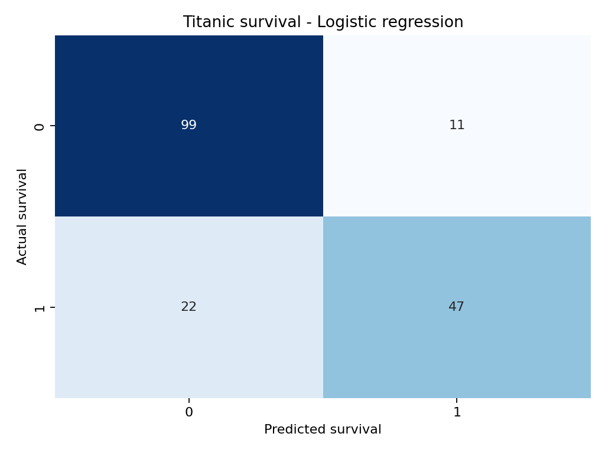

# Titanic Survival Classification

An interpretable classification project based on Kaggle's **Titanic Machine Learning from Disaster** challenge. The objective is to predict whether a passenger survived using demographic and journey information.

## Business-style question

Which passenger characteristics are associated with survival, and how accurately can a straightforward model classify unseen passengers?

## Approach

1. Review data quality, missing values and class balance.
2. Create two transparent features: family size and travelling alone.
3. Keep preprocessing inside a scikit-learn pipeline to prevent data leakage.
4. Compare a majority-class baseline, logistic regression and a decision tree.
5. Select the model using cross-validated ROC-AUC, then evaluate it on a holdout set.

## Results

Logistic regression was the strongest cross-validated model. On the holdout set it achieved **0.816 accuracy, 0.740 F1 and 0.850 ROC-AUC**. Run `python titanic_survival_classification.py` to reproduce the analysis.



## Repository structure

```text
titanic.csv                 Kaggle training data
titanic_survival_classification.py       End-to-end analysis
titanic_survival_classification.ipynb    Executed Jupyter notebook for step-by-step review
requirements.txt            Python dependencies
outputs/                    Saved tables and charts
```

## How to run

```bash
python -m venv .venv
source .venv/bin/activate
pip install -r requirements.txt
python titanic_survival_classification.py
```

To review interactively, open `titanic_survival_classification.ipynb` in Jupyter and run all cells from the project folder.

## Data source

Kaggle challenge: [Titanic Machine Learning from Disaster](https://www.kaggle.com/competitions/titanic)

## Skills demonstrated

Python, pandas, exploratory analysis, missing-value treatment, feature engineering, logistic regression, decision trees, cross-validation and model interpretation.
